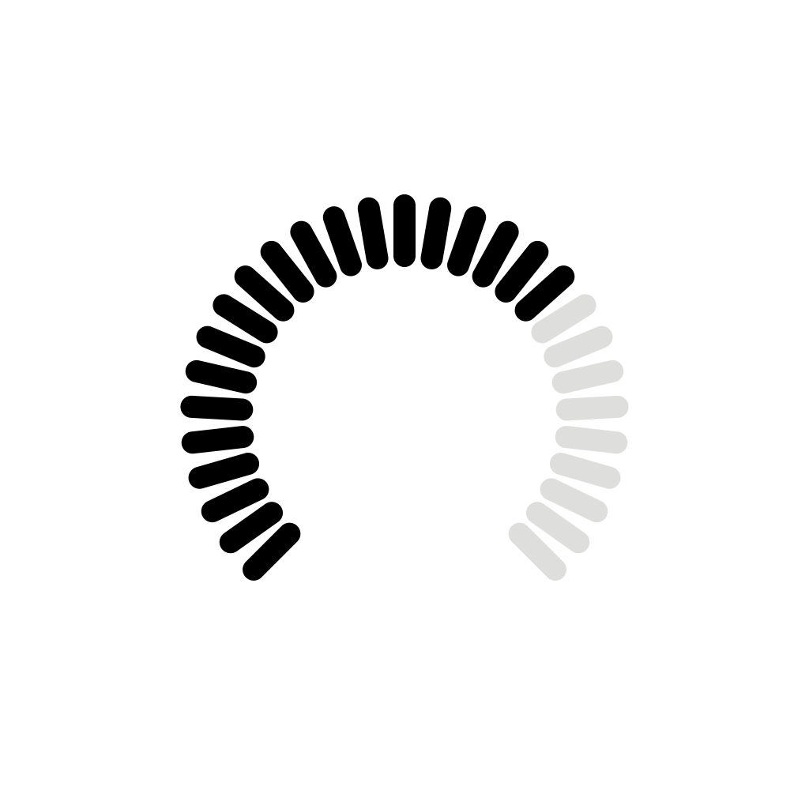
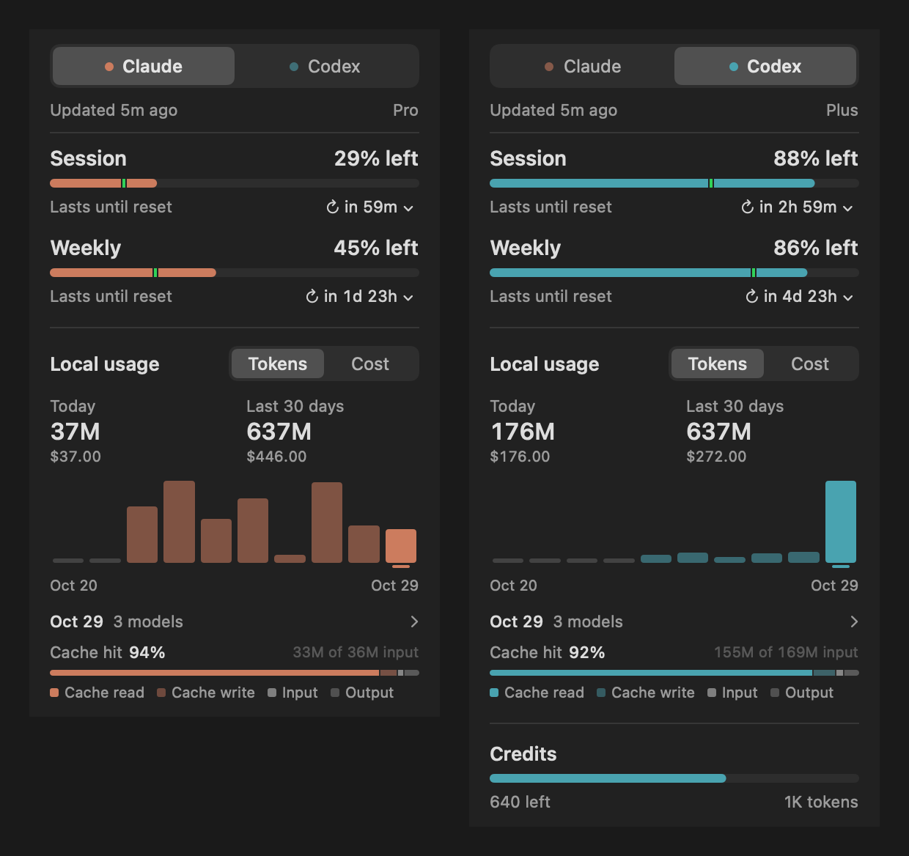
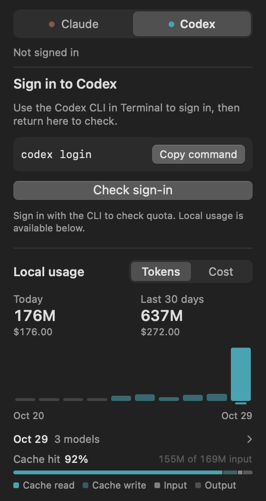
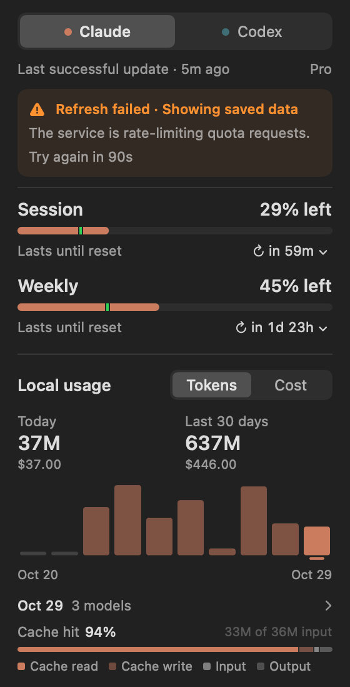
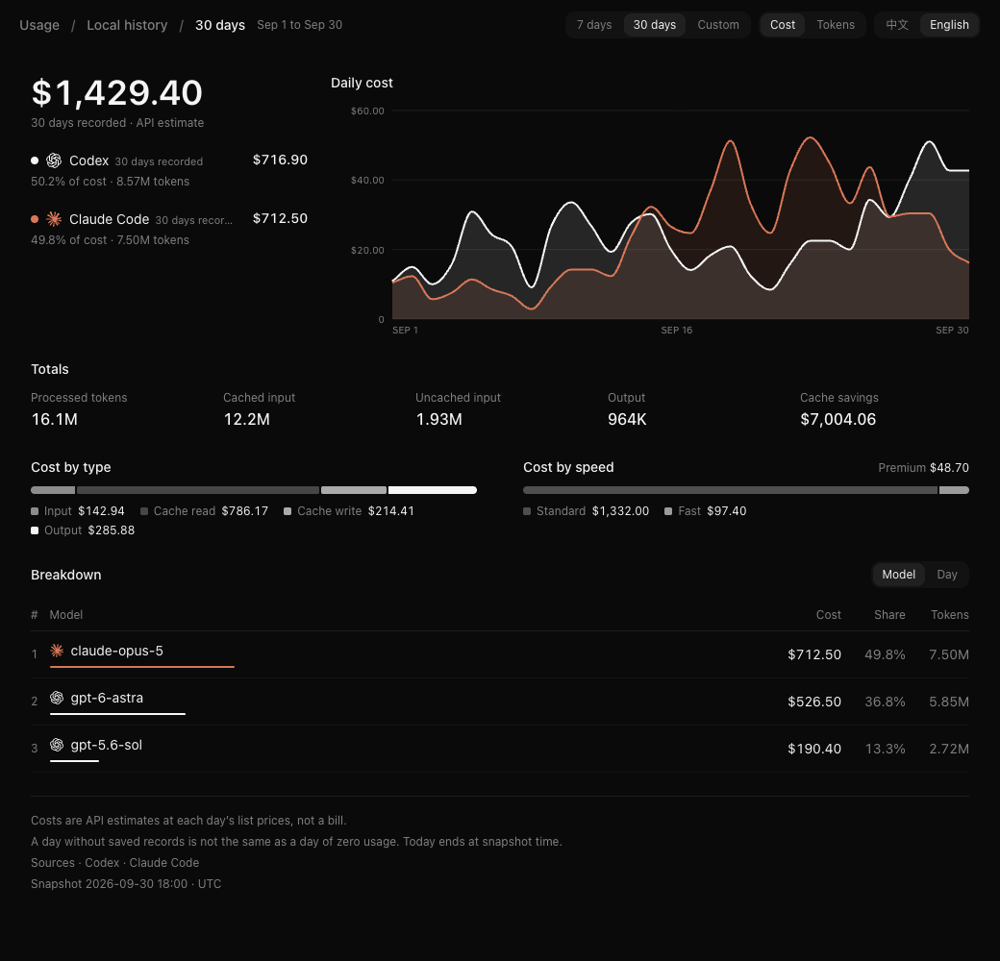
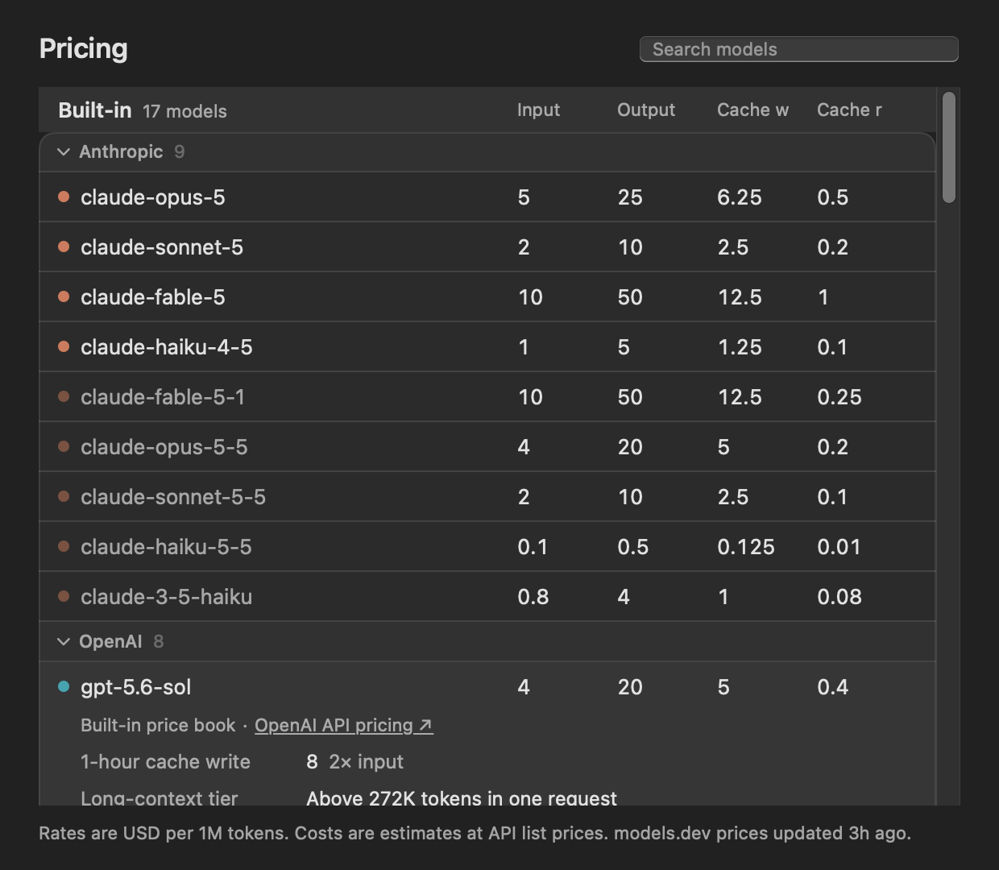

<p align="center">
  
</p>

<h1 align="center">QuotaBar</h1>

<p align="center">
  <a href="README.md"><kbd>English</kbd></a>
  <a href="README.zh-CN.md"><kbd>简体中文</kbd></a>
</p>

Check Codex and Claude quota, reset times, local token usage, and estimated API cost from the macOS menu bar.

[Install](#install) · [First launch](#first-launch) · [Quota](#how-quota-tracking-works) · [Cost](#how-cost-tracking-works) · [Usage](#viewing-usage) · [Pricing](#model-prices) · [Development](#build-and-develop) · [Troubleshooting](#troubleshooting)

Screenshots use sample data. The app is in English; the usage window supports Chinese and English. View the card in [dark](docs/images/interactions/main-dark.png) or [light](docs/images/interactions/main-light.png) appearance.

## Features

- Track session and weekly quota, reset times, usage pace, and Codex credits. Failed refreshes keep the last good reading.
- View tokens and estimated API cost by day and model. Include OpenCode and Pi Agent OAuth usage that matches your Codex account.
- Estimate Standard, Fast, and long-context costs: Claude and OpenAI models from the bundled price book, other models such as DeepSeek or GLM from models.dev.
- View saved usage in a live window that switches between 7 days, 30 days, or any custom period, in Chinese or English.

## Install

Requires macOS 14 or later. Prebuilt releases and the Homebrew cask support Apple Silicon. They do not require Xcode or Swift.

Quota tracking requires an OAuth login through Codex CLI or Claude Code on the same Mac. An API key cannot provide quota readings.

### Homebrew

```bash
brew install --cask softmaxe/tap/quota-bar
```

<details>
<summary>Update or uninstall</summary>

```bash
brew upgrade --cask quota-bar
brew uninstall --cask quota-bar
```

To remove the app and its saved data:

```bash
brew uninstall --zap --cask quota-bar
```

</details>

<details>
<summary>Manual download and first-launch security prompt</summary>

Download the `arm64` ZIP from [GitHub Releases](https://github.com/softmaxe/quota-bar/releases), unzip it, and move `QuotaBar.app` to `/Applications`.

Download the matching `.sha256` file into the same directory as the ZIP. Run this command there before unzipping:

```bash
shasum -a 256 -c QuotaBar-*-macos-arm64.zip.sha256
```

Release ZIPs also carry a build provenance attestation. To confirm that this repository's release workflow built the ZIP, run this with the GitHub CLI:

```bash
gh attestation verify QuotaBar-*-macos-arm64.zip --repo softmaxe/quota-bar
```

Releases are ad hoc signed, not notarized with an Apple Developer ID. If macOS blocks the first launch, try opening the app once, then go to **System Settings → Privacy & Security** and choose **Open Anyway**. As a fallback, after confirming the app is in `/Applications`, remove quarantine from this app only:

```bash
xattr -dr com.apple.quarantine /Applications/QuotaBar.app
```

</details>

## First launch

Sign in through each CLI you want to track. QuotaBar reuses its credentials and has no separate login flow:

```bash
codex login
claude
```

Open QuotaBar, click its menu bar icon, and select Claude or Codex. Open [Settings](docs/images/settings-general.png) to pick the provider the menu bar shows from cards with each one's live quota, choose the refresh interval or **Manual**, and turn models.dev pricing on or off under **Price sources**, to [see model prices](#model-prices), or to [back up saved usage](#backing-up-saved-usage).

If a provider is not signed in, choose **Copy command**, run it in Terminal, then return and choose **Check sign-in**.

QuotaBar reads Codex credentials from `$CODEX_HOME/auth.json`, or `~/.codex/auth.json` by default. It reads Claude credentials from the `Claude Code-credentials` entry in macOS Keychain.

Reading Claude credentials may trigger a macOS Keychain prompt. If a manual **Refresh** receives HTTP 401, QuotaBar lets Claude Code attempt one short credential refresh. Automatic refreshes never start Claude Code. They skip a Claude token that has expired or was already rejected, and try again once Claude Code writes a new one or you choose **Refresh**.

## How quota tracking works

<p align="center">
  
</p>

### Quota windows and usage pace

Each quota window shows the percentage left and its reset time. Click a reset time and choose **Show reset date** or **Show countdown** to change the display for both windows. Unlimited sessions show **Session ∞** and **No limit**. An empty window shows **Limit reached**.

Each bar carries a pace marker where the fill would sit at an even pace: red when you are spending faster than that, green when you have a reserve. QuotaBar compares usage with time elapsed. Once a few days of samples exist, weekly pace counts the hours you are usually active rather than the raw clock. A session that stops moving shows the working time left instead of a run-out time. After at least three comparable recorded weekly windows, it also uses that history to estimate weekly pace. Quota samples are kept for 56 days.

After QuotaBar detects a reset, opening the card plays a brief bar animation while the headline shows the new reading. The app respects macOS Reduce Motion.

### Refresh and recovery

Choose manual refresh or an interval of 1, 2, 5, 15, or 30 minutes in Settings. The default is 5 minutes.

- Polling, opening the card, and clicking **Refresh** update only the selected provider. Switching tabs requests an update for the newly selected provider.
- Each provider has a one-minute refresh cooldown. A server rate limit can extend the wait.
- An explicit Claude credential-recovery action can bypass the local cooldown, but still respects the server limit.

A failed refresh keeps the last good quota and shows its age and recovery instructions at the top. The retry control shows the remaining wait when a cooldown applies. Local scanning has its own progress and **Retry local scan** action.

<details>
<summary>Sign-in and refresh-failure examples</summary>

<table align="center">
  <tr><th>Sign-in guidance</th><th>Refresh failure with saved quota</th></tr>
  <tr>
    <td valign="top"></td>
    <td valign="top"></td>
  </tr>
</table>

</details>

### Menu bar and shortcuts

The menu bar gauge shows the selected provider's status. Its 11 ticks show what is left of the session window, or of the weekly window when the provider reports no session window. It dims after a failed refresh and fades further when no data is available.

<p align="center">
  
</p>

The card scrolls when needed and reopens with details collapsed. These shortcuts work while the card is open:

| Shortcut | Action |
| --- | --- |
| ⌘1 / ⌘2 | Show Claude / Codex |
| ⌘R | Refresh or check sign-in, when available |
| ⌘U | Open the usage window |
| ⌘, | Open settings |
| ⌘Q | Quit |
| Esc | Close the card |

## How cost tracking works

QuotaBar counts tokens in local session logs and estimates what that usage would cost at API rates. These estimates are not subscription charges or billing statements.

### Reading the chart

Choose **Tokens** or **Cost** above the chart. The chart shows the last 10 calendar days; the summary shows the selected day and the last 30 days, each with its value in the other unit underneath.

Hover to preview a day, click to pin it, or use the Left and Right Arrow keys when a date is focused. The summary's first figure follows the selection and reads **Today** until another day is chosen. Under that row, **Cache hit** gives the share of the day's input served from the prompt cache, over a bar of its cache reads, cache writes, fresh input, and output. Click the row under the chart to list that day's models and keep the date fixed. Each model shows the mark of the tool that used it, a bolt for Fast usage, and a bar of its share of the day in the chosen unit. Click the pinned day again, or reopen the card, to resume hover previews. Switching units keeps the selected date.

The chart distinguishes zero usage from missing data:

| Display | Meaning |
| --- | --- |
| **0** or **$0.00** | The value rounds to zero. The chart shows a solid gray stub. Missing prices are marked separately. |
| **—**, **Not scanned yet** | The date is later than the last completed scan and has no recorded usage. The chart shows a dashed stub. |
| **—** in Cost view | Usage is recorded, but no rate applies. The chart shows a dashed stub. |
| **No price** in a day's model list | The model has no rate on that day. Cost totals include priced usage only, so they leave its tokens out. |

**Settings → Pricing** lists every model with its rates and where they come from. Unpriced models are local or free models, new Claude or OpenAI models the price book does not list yet, and Fast usage of models without a Fast multiplier.

### Data sources

| Source | Local data |
| --- | --- |
| Codex | `$CODEX_HOME/sessions` and `$CODEX_HOME/archived_sessions`, or the same paths under `~/.codex` |
| Claude | `$CLAUDE_CONFIG_DIR/projects`, or `~/.claude/projects` and `~/.config/claude/projects` |
| OpenCode | `$OPENCODE_DATA_HOME/opencode.db`, `$XDG_DATA_HOME/opencode/opencode.db`, or `~/.local/share/opencode/opencode.db` |
| Pi Agent | `$PI_CODING_AGENT_SESSION_DIR`, `$PI_CODING_AGENT_DIR/sessions`, or `~/.pi/agent/sessions` |

For OpenCode `openai` usage and Pi Agent `openai-codex` assistant usage, QuotaBar checks each app's current OAuth credentials against the Codex account. Matching usage counts toward Codex totals. Other providers, API-key credentials, and account mismatches are excluded. These totals do not affect quota bars. See [Limitations](#limitations) for historical OpenCode authentication changes.

### Remote machines

To count Claude Code and Codex sessions from another machine, add its SSH host under **Settings → Remote**, or pick it from **From SSH config**. QuotaBar copies the machine's `.jsonl` logs with `rsync` over `ssh` when the host is added, when the app starts, every 15 minutes, and when you press **Sync now**. With **Sync automatically** off, only adding a host and **Sync now** connect. Each row shows when the host last synced or why it failed, how many usage records its logs hold, how many of those are new, and how many files were copied. New records are the ones no other log recorded first, so a host whose sessions are already here can sync successfully with few or none. A machine that is off only delays its own sync.

The host needs key-based SSH sign-in that works without a prompt, and `rsync` installed. QuotaBar reads `~/.claude/projects`, `~/.config/claude/projects`, `~/.codex/sessions`, and `~/.codex/archived_sessions` on the machine, not custom `CLAUDE_CONFIG_DIR` or `CODEX_HOME` locations. OpenCode and Pi Agent are local only.

Remote usage adds to the same totals as this Mac's; the menu and the usage report have no per-machine breakdown. Sessions present on both count once. Removing a host stops syncing it and keeps what was recorded.

### Saved history

The first scan of a large history may take time. QuotaBar saves token counts, dates, models, sources, and pricing tiers in SQLite, along with record IDs and scan positions. It calculates costs when reading that usage.

Saved usage survives source-session deletion and app restarts, including records older than 30 days. Sessions deleted before scanning cannot be recovered.

<details>
<summary>Incremental scanning and database migration</summary>

Codex and Claude resume from the last byte read. OpenCode and Pi Agent deduplicate records by stable IDs. Codex rollout UUIDs prevent archive moves and copies from counting twice.

Scanner upgrades preserve recorded history instead of rebuilding it from source logs.

</details>

### Backing up saved usage

Saved usage outlives the session logs, but it is gone if QuotaBar's own data is deleted too. Open **Settings → Data** to see how much is saved and to keep a copy.

- **Export…** saves one `.sqlite` file wherever you choose, such as an external disk or a synced folder. A backup restores only what was saved by then.
- **Import…** adds what this Mac is missing, so it works on a fresh install, with another Mac's backup, or with an old backup. It never removes usage: a message or rollout on both sides keeps the fuller record, and importing again changes nothing. The database as it stood is kept as `cost-usage.sqlite.pre-import`, replaced by each import.

A backup holds token counts, dates, models, pricing tiers, record IDs, scan positions, and local session paths, so check where you share it. It holds no prompts or replies. Quota pace samples and cached models.dev rates are not included: pace rebuilds as QuotaBar samples quota again, and past third-party costs use the rates downloaded on that Mac.

### Pricing rules

- Every cost is an estimate at API list prices.
- Claude and OpenAI models use the bundled [price book](Sources/QuotaBarCore/Resources/Pricing/price-book.json), which stores rates in dated periods. Each day's usage uses that day's rates.
- Other models use rates from [models.dev](https://models.dev): the model maker's own price when it lists one, otherwise the middle price across providers. QuotaBar keeps them in a local cache and refreshes it at most once a day. When a price changes, earlier days keep the old rates. Models listed only for free stay unpriced. Turn this off under **Settings → General → Price sources**.
- Fast usage (Codex priority tier and Claude Fast mode) multiplies the price book's rates by that period's Fast multiplier, including cache rates. Without a Fast multiplier, and for models priced from models.dev, Fast usage stays unpriced. Claude usage scanned before QuotaBar recorded Fast mode stays Standard.
- Long-context rates apply when a request's input and cache tokens exceed its threshold. QuotaBar records that classification during scanning; later threshold changes do not reclassify saved usage.

Provider billing rules, cache accounting, and price changes can make estimates differ from an invoice. See [Maintaining the price book](docs/pricing.md) to update bundled rates and for how models.dev rates are chosen.

## Viewing usage

Choose **Usage…** in the card, or press ⌘U, to open the usage window. If nothing is saved yet, it says so.

<p align="center">
  
</p>

The page is modelled on the Usage page of [T3 Code](https://github.com/pingdotgg/t3code). It shows all saved Codex and Claude usage, plus eligible OpenCode and Pi Agent usage. Switch between 7 days, 30 days, or a custom start and end date, between cost and tokens, and between Chinese and English. It shows each source's share, a daily line per source, totals with cache savings, cost by token type and speed, and a breakdown by model or by day.

While the window is open, QuotaBar scans every source's local logs once a minute and updates the figures in place, keeping the period, metric, breakdown, and language you chose. It uses the same pricing rules as the card and marks unpriced usage. See [Usage window](docs/usage-report.md) for how it reads and refreshes data.

## Model prices

Open **Settings → Pricing** to see the rates every estimate uses, in USD per million tokens. The table holds the current Claude and OpenAI API models from the price book and every other model found locally, priced from models.dev or unpriced, with each model's four main rates. Built-in, models.dev, and unpriced models sit in separate cards, each grouped by vendor; click a vendor to fold its models away. Within a vendor, models used on this Mac come first, busiest at the top; search narrows the list by name. Click a row to open its one-hour cache write rate, the long-context threshold and the rates above it, its recorded tokens, its source, and a link to the source's own price page. Use the Up and Down Arrow keys to move through the table.

<p align="center">
  
</p>

Rates cannot be edited. To change a Claude or OpenAI rate, update the price book (see [Maintaining the price book](docs/pricing.md)). Earlier versions saved custom rates in `pricing-overrides.json`; this version deletes that file on launch.

## Privacy and network access

QuotaBar reads CLI credentials and local session records. It does not write to CLI credential stores. Manual Claude recovery can launch Claude Code, which may update its own credentials.

QuotaBar uses timestamps, models, token counts, record IDs, and account IDs needed to match OAuth sessions. It does not store prompts, responses, or reasoning text in its usage history or upload them.

[Remote machines](#remote-machines) are the one exception to local-only reading: QuotaBar connects to the SSH hosts you add and copies their whole session logs, which can include prompts and responses, into a directory only your user can read. Nothing is sent to those hosts, and the copies stay after a host is removed. Delete `cost-usage/remote-logs` to remove them; recorded usage stays.

<details>
<summary>Local storage paths</summary>

```text
~/Library/Application Support/QuotaBar/usage-history.json
~/Library/Application Support/QuotaBar/third-party-rates.json
~/Library/Application Support/QuotaBar/cost-usage/cost-usage.sqlite
~/Library/Application Support/QuotaBar/cost-usage/cost-usage.sqlite.pre-import   # before the latest import
~/Library/Application Support/QuotaBar/cost-usage/remote-logs/   # copies from remote machines
~/Library/Preferences/com.quotabar.app.plist
~/Library/WebKit/com.quotabar.app        # usage report view settings
```

</details>

Codex quota requests use the `chatgpt_base_url` in `$CODEX_HOME/config.toml`, if set, or the default ChatGPT endpoint. QuotaBar also contacts `auth.openai.com` to refresh Codex tokens, and `api.anthropic.com` for Claude quota. Claude and OpenAI prices ship with the app. While **models.dev** is on under **Price sources**, QuotaBar downloads `https://models.dev/api.json` at most once a day; the request carries no usage or account data. It does not send local session records to these services.

## Build and develop

Building requires full Xcode with a Swift 6 toolchain. The project uses Swift Package Manager. `Scripts/swift.sh` defaults to `/Applications/Xcode.app/Contents/Developer` without changing the global `xcode-select` setting.

The release workflow requires the macOS 27 SDK for native menu bar sessions on macOS 27. Local builds with older SDKs use the legacy menu bar handling. The minimum runtime remains macOS 14.

```bash
git clone https://github.com/softmaxe/quota-bar.git
cd quota-bar
make app
open build/QuotaBar.app
```

To use another full Xcode installation, set `DEVELOPER_DIR` to its `Contents/Developer` directory:

```bash
DEVELOPER_DIR=/Applications/Xcode-beta.app/Contents/Developer \
make app
```

<details>
<summary>Development commands</summary>

| Command | Purpose |
| --- | --- |
| `make build` | Build the debug binary. |
| `make run` | Build and run in the foreground. |
| `make preview` | Open the isolated sample interface without stopping the installed app. |
| `make card-snapshot` | Render offscreen card images to `.build/screenshots/card`. |
| `make test` | Run core assertions and UI/policy verifiers. |
| `make probe` | Check both provider integrations. |
| `make probe-cost` | Rescan local logs and print cost totals. |
| `make benchmark-startup` | Measure status-item construction offline in a debug build. |
| `make benchmark-cost` | Benchmark Codex scans with offline pricing; reads local logs. |
| `make benchmark-cost PROVIDER=claude` | Benchmark Claude with the same offline pricing. |
| `make logs` | Stream logs for `com.quotabar.app`. |
| `make readme-assets` | Rebuild screenshots and state examples. |
| `make clean` | Remove build output. |

`make probe` prints account and usage metadata. Review its output before sharing it.

</details>

<details>
<summary>UI previews and screenshots</summary>

To preview interactions with sample quota and cost data, run:

```bash
make preview
```

Set `PREVIEW_STATE=signed-out`, `stale`, or `motion` to inspect those states; the default is `loaded`. Preview uses isolated preferences and temporary history. It does not read credentials, contact providers, or scan real logs. Choose **Quit** in the preview to clear its temporary data. Running it alongside the installed app adds a second menu bar icon.

`make card-snapshot` writes offscreen card images to `.build/screenshots/card`. Set `SNAPSHOT_DIR` to write somewhere else.

`make readme-assets` renders both READMEs' shared images from the current views with sample data, including the light and dark card, sign-in, and refresh-failure states. Regenerate them after changing the UI.

Image generation requires ffmpeg. The report screenshot also needs Node.js and Playwright from `playwright-cli` or `PLAYWRIGHT_MODULE`. It uses Brave by default, or the browser at `CHROMIUM_PATH`. See [report development checks](docs/usage-report.md#verification) and [rendering notes](docs/design-implementation.md).

</details>

<details>
<summary>Packaging and releases</summary>

To create a test package, run **Build and Release** from the repository's **Actions** tab and select the branch to build. Manual runs upload a development ZIP and SHA-256 file as workflow artifacts without publishing a release.

To publish a release, push a tag matching `vMAJOR.MINOR.PATCH`. The tag supplies the app's version. Local `make app` builds use the nearest reachable release tag, or `0.0.0` if none exists. Set `VERSION` to override it.

The workflow packages an `arm64` ZIP and verifies its signature, version, architecture, and checksum. It does not rerun tests, because every commit on `main` already passed PR checks. It then publishes a GitHub Release and updates `softmaxe/homebrew-tap`. Tagged runs must point at a commit on `main` and require the `HOMEBREW_TAP_TOKEN` secret in the `homebrew-tap` environment, which only `v*.*.*` tags can use. Both **Release** and **Update Homebrew tap** must succeed.

</details>

## Troubleshooting

| Problem | What to check |
| --- | --- |
| Provider is not signed in | Copy the command in the card, complete the CLI login, then choose **Check sign-in**. Use `make probe` for the raw error. |
| Data is stale or refresh returns HTTP 429 | Read the warning above the saved quota. Wait for the retry countdown, then retry; a server limit may last longer than one minute. |
| Local scan failed | Read the local usage error and choose **Retry local scan**. Confirm the CLI writes session logs to the paths above. |
| Cost shows — or a model shows No price | Check the model in **Settings → Pricing**. Local, free, and Fast third-party usage stays unpriced. For other models, confirm models.dev is on under **Settings → General → Price sources** and that models.dev lists the model. |
| A date shows Not scanned yet | Wait for the local scan to finish. This means the date is not covered yet, rather than zero usage. |
| OpenCode usage is missing | Confirm OpenCode uses `openai` OAuth with the same account as Codex. Check **Settings → Pricing** for database or authentication errors. |
| Pi Agent usage is missing | Confirm Pi Agent uses `/login openai-codex` with the same account as Codex. Check **Settings → Pricing** for session or authentication errors. |

## Limitations

- Prebuilt releases and the Homebrew cask support Apple Silicon only. Release ZIPs are ad hoc signed and not notarized.
- Claude credential recovery runs only after a manual **Refresh** and may still require opening Claude Code for interactive sign-in.
- Cost figures come from local logs and are not billing statements.
- OpenCode does not save the authentication method for each historical request. QuotaBar cannot reconstruct an OAuth to API key to OAuth switch that happened while it was not running.

## License and acknowledgements

QuotaBar is licensed under [AGPL-3.0](LICENSE). Code adapted from CodexBar remains available under its MIT terms. See [THIRD_PARTY_NOTICES.md](THIRD_PARTY_NOTICES.md).

QuotaBar is a rebuild of [CodexBar](https://github.com/steipete/CodexBar) and uses its ideas and implementation details. Copyright © 2026 Peter Steinberger.
