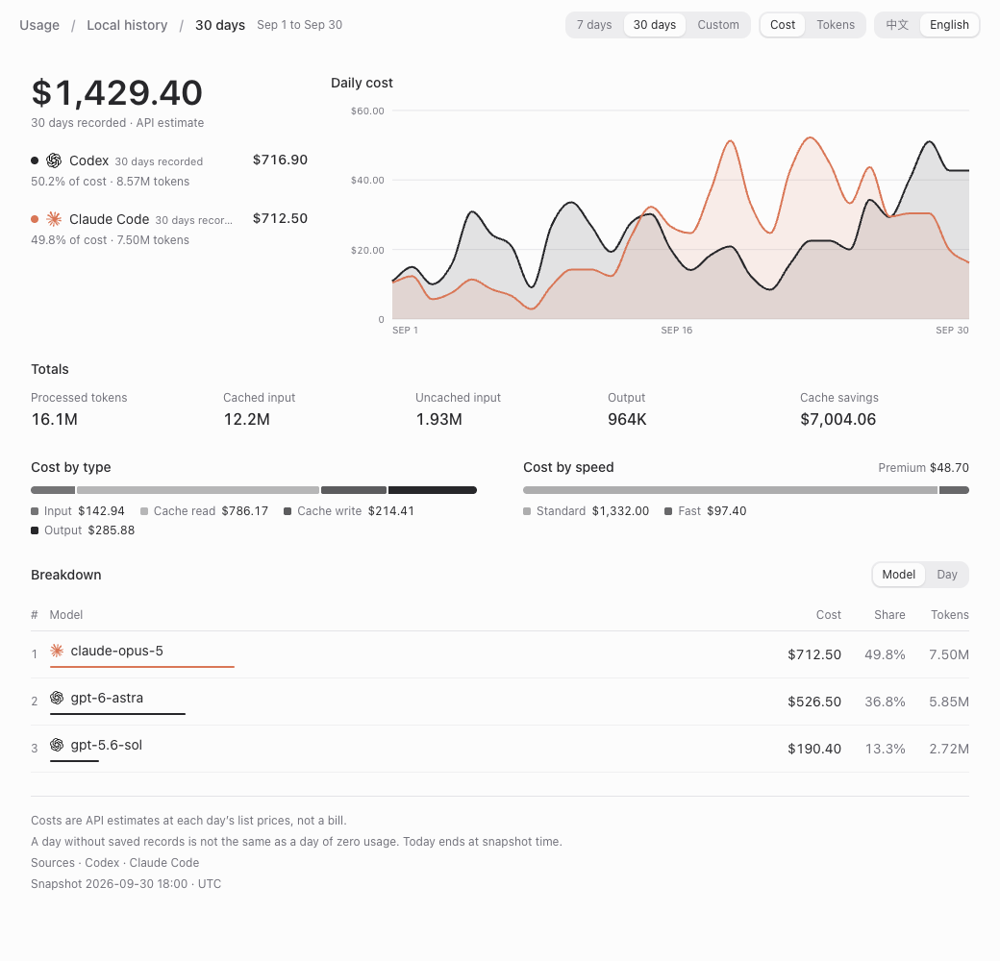

<p align="center">
  
</p>

<h1 align="center">QuotaBar</h1>

<p align="center">
  <a href="README.md"><kbd>English</kbd></a>
  <a href="README.zh-CN.md"><kbd>简体中文</kbd></a>
</p>

在 macOS 菜单栏查看 Codex 和 Claude 的剩余额度、重置时间、本地 token 用量与预估 API 成本。

[安装](#安装) · [首次使用](#首次使用) · [额度](#额度统计方式) · [成本](#成本统计方式) · [报告](#导出用量报告) · [费率](#模型费率) · [开发](#构建与开发) · [排查](#排查)

截图使用示例数据。应用界面为英文，导出的报告支持中英文切换。也可以查看卡片的[深色](docs/images/interactions/main-dark.png)与[浅色](docs/images/interactions/main-light.png)外观。

## 功能

- 查看会话与每周额度、重置时间、使用节奏和 Codex Credits 余额。刷新失败时保留上次有效读数。
- 按日期和模型查看 token 用量与预估 API 成本，将匹配 Codex 账号的 OpenCode 和 Pi Agent OAuth 用量计入总计。
- 估算 Standard、Fast 和长上下文成本：Claude 和 OpenAI 模型使用内置价格表，DeepSeek、GLM 等其他模型使用 models.dev 的价格。
- 将最近 7 天或 30 天的已保存用量导出为离线 HTML 报告，支持中英文切换。

## 安装

要求 macOS 14 或更新版本。预编译版本和 Homebrew cask 支持 Apple Silicon，无需安装 Xcode 或 Swift。

额度统计需要在同一台 Mac 上通过 Codex CLI 或 Claude Code 完成 OAuth 登录。API key 无法提供额度读数。

### Homebrew

```bash
brew install --cask softmaxe/tap/quota-bar
```

<details>
<summary>更新或卸载</summary>

```bash
brew upgrade --cask quota-bar
brew uninstall --cask quota-bar
```

同时删除应用数据：

```bash
brew uninstall --zap --cask quota-bar
```

</details>

<details>
<summary>手动下载与首次启动安全提示</summary>

从 [GitHub Releases](https://github.com/softmaxe/quota-bar/releases) 下载 `arm64` ZIP，解压后将 `QuotaBar.app` 移到 `/Applications`。

将对应的 `.sha256` 文件下载到 ZIP 所在目录。解压前在该目录运行：

```bash
shasum -a 256 -c QuotaBar-*-macos-arm64.zip.sha256
```

发布包使用 ad hoc 签名，未通过 Apple Developer ID 公证。若 macOS 首次启动时阻止打开，请先尝试打开一次，再前往 **系统设置 → 隐私与安全性**，选择 **仍要打开**。如果仍无法打开，确认应用位于 `/Applications` 后，可以只移除这个应用的隔离属性：

```bash
xattr -dr com.apple.quarantine /Applications/QuotaBar.app
```

</details>

## 首次使用

通过需要统计的 CLI 登录。QuotaBar 复用其凭据，没有单独的登录流程：

```bash
codex login
claude
```

打开 QuotaBar，点击菜单栏图标，选择 Claude 或 Codex。在 [Settings](docs/images/settings-general.png) 中修改刷新间隔、菜单栏显示的供应商，以及是否用 models.dev 为其他模型计价，或[查看模型费率](#模型费率)。

未登录时，点击 **Copy command**，在终端中执行命令，登录后返回并点击 **Check sign-in**。

QuotaBar 从 `$CODEX_HOME/auth.json` 读取 Codex 凭据，默认路径为 `~/.codex/auth.json`。Claude 凭据来自 macOS 钥匙串中的 `Claude Code-credentials` 条目。

读取 Claude 凭据时，macOS 可能弹出钥匙串授权提示。如果手动 **Refresh** 收到 HTTP 401，QuotaBar 会让 Claude Code 尝试一次短时凭据刷新。自动刷新不会启动 Claude Code。Claude token 已过期或已被拒绝时，自动刷新会跳过请求，等 Claude Code 写入新 token 或你点击 **Refresh** 后再试。

## 额度统计方式

<p align="center">
  
</p>

### 额度窗口与使用节奏

每个额度窗口显示剩余百分比和重置时间。点击重置时间并选择 **Show reset date** 或 **Show countdown**，可同时切换两个窗口的重置时间显示方式。无限额会话显示 **Session ∞** 和 **No limit**，额度用尽时显示 **Limit reached**。

展开 **Usage pace details**，可查看额度储备、缺口和使用余量。QuotaBar 会比较用量与已过时间。积累至少三个可比较的周窗口后，也会用这些历史记录估算每周节奏。额度采样保留 56 天。

检测到额度重置后，打开卡片时会播放简短的额度条动画，标题显示新读数。应用遵循 macOS 的减弱动态效果设置。

### 刷新与错误恢复

在设置中选择手动刷新，或每 1、2、5、15、30 分钟刷新一次，默认 5 分钟。

- 定时刷新、打开卡片和点击 **Refresh** 都只更新当前供应商。切换标签页时，会请求更新新选中的供应商。
- 每家供应商有独立的一分钟刷新冷却，服务端限流可能延长等待时间。
- 手动触发 Claude 凭据恢复时可以跳过本地冷却，但仍受服务端限制。

刷新失败时，卡片保留最后一次有效的额度，在顶部显示数据距今时间和恢复指引。冷却期间，重试控件会显示剩余等待时间。本地扫描单独显示进度，并提供 **Retry local scan** 操作。

<details>
<summary>登录与刷新失败示例</summary>

<table align="center">
  <tr><th>登录指引</th><th>刷新失败时保留额度</th></tr>
  <tr>
    <td valign="top"></td>
    <td valign="top"></td>
  </tr>
</table>

</details>

### 菜单栏与快捷键

菜单栏机器人显示当前供应商的状态。任一额度窗口剩余 10% 或更少时，机器人变红，已过重置时间的窗口除外。刷新失败时图标变淡，还没有数据时更淡。

<p align="center">
  
</p>

图标来自 Material Design Icons 的 `robot-excited`。卡片内容过长时可滚动，重新打开时详情收起。以下快捷键在卡片打开时生效：

| 快捷键 | 操作 |
| --- | --- |
| ⌘1 / ⌘2 | 查看 Claude / Codex |
| ⌘R | 可用时刷新或检查登录状态 |
| ⌘, | 打开设置 |
| ⌘Q | 退出 |
| Esc | 关闭卡片 |

## 成本统计方式

QuotaBar 统计本地会话日志中的 token，估算这些用量按 API 费率计价的成本。这些数字不代表订阅费用或实际账单。

### 查看图表

在图表上方选择 **Tokens** 或 **Cost**。图表显示最近 10 个日历日，摘要显示当天和最近 30 天的总计。

悬停可预览某天，点击可固定日期，日期获得焦点后也可用左右方向键切换。展开 **Model breakdown** 可查看当天的模型明细，并固定日期。重新打开卡片可恢复悬停预览，切换单位会保留选中日期。

图表区分零用量和缺失数据：

| 显示 | 含义 |
| --- | --- |
| **0** 或 **$0.00** | 数值在当前显示精度下为零，图表显示实心灰色短条。缺失费率会另行标注。 |
| **—**、**Not scanned yet** | 该日期晚于最后一次完成扫描的日期，且没有记录到用量。图表显示虚线短条。 |
| **—**、**Unpriced** | 已记录用量，但没有适用的费率。Cost 视图显示虚线短条。 |
| **Partial estimate** | 金额只包含有费率的用量，没有费率的部分未计入。 |

**Settings → Pricing** 列出每个模型的费率及其来源。未计价的通常是本地或免费模型、价格表尚未收录的新 Claude 或 OpenAI 模型，以及没有 Fast 倍率的 Fast 用量。

### 数据来源

| 来源 | 本地数据 |
| --- | --- |
| Codex | `$CODEX_HOME/sessions` 和 `$CODEX_HOME/archived_sessions`；未设置时使用 `~/.codex` 下的同名目录 |
| Claude | `$CLAUDE_CONFIG_DIR/projects`，或 `~/.claude/projects` 和 `~/.config/claude/projects` |
| OpenCode | `$OPENCODE_DATA_HOME/opencode.db`、`$XDG_DATA_HOME/opencode/opencode.db`，或 `~/.local/share/opencode/opencode.db` |
| Pi Agent | `$PI_CODING_AGENT_SESSION_DIR`、`$PI_CODING_AGENT_DIR/sessions`，或 `~/.pi/agent/sessions` |

对于 OpenCode 的 `openai` 用量和 Pi Agent 的 `openai-codex` 助手用量，QuotaBar 会将各应用当前的 OAuth 凭据与 Codex 账号匹配，匹配成功后计入 Codex 总计。其他供应商、API key 凭据和账号不匹配的数据不计入。这些总计不会改变额度条。OpenCode 历史认证方式变更的处理限制见[已知限制](#已知限制)。

### 历史记录

首次扫描大量历史记录可能需要一些时间。QuotaBar 用 SQLite 保存 token 数量、日期、模型、来源和计价档位，以及记录 ID 和扫描位置。成本在读取或导出用量时计算。

删除源会话或重启应用不会丢失已保存用量，超过 30 天的记录也会保留。扫描前就被删除的会话无法恢复。

<details>
<summary>增量扫描与数据库迁移</summary>

Codex 和 Claude 从上次读到的字节继续扫描，OpenCode 和 Pi Agent 按稳定 ID 去重。Codex rollout UUID 能避免归档移动或复制后被重复计算。

扫描器升级时保留已记录的历史，不会从源日志重建。

</details>

### 计价规则

- 所有成本都是按 API 公开价格的估算。
- Claude 和 OpenAI 模型使用内置[价格表](Sources/QuotaBarCore/Resources/Pricing/price-book.json)。价格表按生效日期分段记录费率，每天的用量使用当天的费率。
- 其他模型使用 [models.dev](https://models.dev) 的费率：模型厂商自己有报价时用厂商价，否则取各家供应商报价的中间值。QuotaBar 把这些费率缓存在本地，每天最多更新一次；价格变化后，之前的日期仍按旧费率计算。只有免费报价的模型保持未计价。可在 **Settings → General** 中关闭。
- Fast 用量（Codex priority 层级和 Claude Fast mode）使用价格表中的费率乘以该时段的 Fast 倍率，缓存费率同样适用。没有 Fast 倍率的模型，以及使用 models.dev 计价的模型，其 Fast 用量保持未计价状态。QuotaBar 开始记录 Fast mode 之前扫描的 Claude 用量仍按 Standard 计价。
- 单次请求的输入和缓存 token 总数超过阈值时，使用长上下文费率。QuotaBar 在扫描时记录这一归类，之后修改阈值不会重新归类已保存的用量。

供应商计费规则、缓存计算方式和价格变化，都可能让估算结果与账单不同。更新内置费率的方法以及 models.dev 费率的选取方式见[维护价格表](docs/pricing.md)。

## 导出用量报告

1. 打开 **Settings → Export**，也可以在设置窗口中按 ⌘3。
2. 选择 **Last 7 days** 或 **Last 30 days**。
3. 如需导出后立即查看，保留 **Open after export** 勾选。
4. 点击 **Export Report…** 并选择保存位置。如果所选时段没有已保存的用量，QuotaBar 会先提示，不会打开保存对话框。

<p align="center">
  
</p>

报告是一个可离线打开、切换中英文的 HTML 文件，包含所选时段已保存的 Codex、Claude 用量，以及符合条件的 OpenCode 和 Pi Agent 用量。图表和可展开的数据表展示每日用量、按模型汇总的成本，以及 token 与缓存构成。

导出只读取已保存的数据和缓存的费率，不刷新额度、重扫日志或请求网络。报告使用与卡片相同的计价规则，并标注未计价用量。总额包含缓存成本，报告列出缓存 token 数量，不单独列出缓存成本。

文件包含时段、生成时间、时区、来源、模型、token 数量和估算成本，不含提示词、回复、推理文本、凭据和账号 ID。完整的数据格式与验证方法见[用量报告导出](docs/usage-report-export.md)。

## 模型费率

打开 **Settings → Pricing**，可以查看所有估算使用的费率，单位为美元/百万 token。列表分为 **Claude**、**Codex** 和 **Others** 三组：前两组来自价格表，**Others** 列出本地发现的其他模型，由 models.dev 计价或未计价。展开模型行可以查看一小时缓存写入费率、长上下文阈值及超过阈值后的费率。点击列标题排序；恢复默认顺序后，API 模型回到固定顺序，**Others** 按用量排序。

<p align="center">
  
</p>

费率不可编辑。如需修改 Claude 或 OpenAI 的费率，请更新价格表（见[维护价格表](docs/pricing.md)）。旧版本把自定义费率保存在 `pricing-overrides.json`，此版本启动时会删除该文件。

## 隐私与网络

QuotaBar 会读取 CLI 凭据和本地会话记录，不会写入 CLI 的凭据存储。手动恢复 Claude 凭据时，QuotaBar 可以启动 Claude Code，由后者更新自己的凭据。

统计会使用时间、模型、token 数量、记录 ID，以及匹配 OAuth 会话所需的账号 ID。QuotaBar 不会将提示词、回复和推理文本写入用量历史或上传。

<details>
<summary>本地存储路径</summary>

```text
~/Library/Application Support/QuotaBar/usage-history.json
~/Library/Application Support/QuotaBar/third-party-rates.json
~/Library/Application Support/QuotaBar/cost-usage/cost-usage.sqlite
~/Library/Preferences/com.quotabar.app.plist
```

</details>

Codex 额度请求会使用 `$CODEX_HOME/config.toml` 中的 `chatgpt_base_url`；未设置时使用 ChatGPT 默认接口。QuotaBar 还会请求 `auth.openai.com` 刷新 Codex token、请求 `api.anthropic.com` 获取 Claude 额度。Claude 和 OpenAI 的价格随应用发布。开启 **Price other models with models.dev** 时，QuotaBar 每天最多请求一次 `https://models.dev/api.json`，请求不携带用量或账号数据。本地会话记录不会发送到这些服务。

## 构建与开发

构建需要完整的 Xcode 及 Swift 6 工具链。项目使用 Swift Package Manager。`Scripts/swift.sh` 默认使用 `/Applications/Xcode.app/Contents/Developer`，不会修改全局 `xcode-select` 设置。

发布工作流要求 macOS 27 SDK，以支持 macOS 27 的原生菜单栏会话。使用较旧 SDK 的本地构建会采用旧版菜单栏处理方式。最低运行系统仍为 macOS 14。

```bash
git clone https://github.com/softmaxe/quota-bar.git
cd quota-bar
make app
open build/QuotaBar.app
```

如需使用其他完整 Xcode，将 `DEVELOPER_DIR` 设为其 `Contents/Developer` 目录：

```bash
DEVELOPER_DIR=/Applications/Xcode-beta.app/Contents/Developer \
make app
```

<details>
<summary>开发命令</summary>

| 命令 | 用途 |
| --- | --- |
| `make build` | 构建调试版本。 |
| `make run` | 构建并在前台运行。 |
| `make test` | 运行核心断言和界面、行为规则验证。 |
| `make probe` | 检查两家供应商的集成。 |
| `make probe-cost` | 重新扫描本地日志并输出成本总计。 |
| `make benchmark-startup` | 使用调试版本，离线测量菜单栏项目的创建耗时。 |
| `make benchmark-cost` | 使用离线价格测试 Codex 扫描性能，会读取本地日志。 |
| `make benchmark-cost PROVIDER=claude` | 使用相同的离线价格测试 Claude 扫描性能。 |
| `make logs` | 持续显示 `com.quotabar.app` 的日志。 |
| `make readme-assets` | 重新生成截图和状态示例。 |
| `make clean` | 删除构建产物。 |

`make probe` 会输出账号和用量元数据，分享前请先检查内容。

</details>

<details>
<summary>界面预览与截图</summary>

如需用示例额度和成本数据预览交互，运行：

```bash
make build
.build/debug/QuotaBar --preview-interface loaded
```

将 `loaded` 换成 `signed-out` 或 `stale`，可以查看对应状态。预览使用隔离的偏好设置和临时历史记录，不读取凭据、不请求供应商接口，也不扫描真实日志。通过预览中的 **Quit** 清理临时数据。与已安装的应用同时运行时，菜单栏会多出一个图标。

`make readme-assets` 使用当前视图和示例数据，重新生成两版 README 共用的图片，包括登录、刷新失败和无效费率状态。修改界面后应同步生成图片。

生成图片需要 ffmpeg。报告截图还需要 Node.js，以及通过 `playwright-cli` 或 `PLAYWRIGHT_MODULE` 提供的 Playwright。默认使用 Brave，也可通过 `CHROMIUM_PATH` 指定浏览器。详见[报告开发验证](docs/usage-report-export.md#verification)和[渲染说明](docs/design-implementation.md)。

</details>

<details>
<summary>打包与发布</summary>

如需生成测试包，在仓库的 **Actions** 页面手动运行 **Build and Release**，并选择要构建的分支。手动运行会将开发版 ZIP 和 SHA-256 文件上传为工作流产物，不会发布 Release。

发布正式版本时，推送符合 `vMAJOR.MINOR.PATCH` 格式的 Git 标签，由标签决定应用版本号。本地 `make app` 使用当前提交历史中最近的发布标签，没有时使用 `0.0.0`。设置 `VERSION` 可覆盖版本号。

工作流会运行测试、打包 `arm64` ZIP，并校验签名、版本、架构和校验和。随后发布 GitHub Release，再更新 `softmaxe/homebrew-tap`。标签必须指向 `main` 上的提交，并需要 `release` 环境中的 `TAP_GITHUB_TOKEN` secret，该环境只允许 `v*` 标签使用。**Release** 和 **Update Homebrew tap** 都必须成功。

</details>

## 排查

| 问题 | 检查方法 |
| --- | --- |
| 供应商显示未登录 | 复制卡片中的命令，完成 CLI 登录后点击 **Check sign-in**。使用 `make probe` 查看原始错误。 |
| 数据过期或刷新返回 HTTP 429 | 查看已保存额度上方的警告，等待倒计时结束后重试。服务端限制可能超过一分钟。 |
| 本地扫描失败 | 查看本地用量区域的错误，点击 **Retry local scan**。确认 CLI 正在向上面的路径写入会话日志。 |
| 成本显示 Unpriced 或 Partial estimate | 在 **Settings → Pricing** 中查看该模型。本地模型、免费模型和第三方模型的 Fast 用量保持未计价。其他模型请确认 **Settings → General** 中已开启 models.dev 计价，且 models.dev 收录了该模型。 |
| 日期显示 Not scanned yet | 等待本地扫描完成。这表示该日期尚未被扫描覆盖，不代表零用量。 |
| 缺少 OpenCode 用量 | 确认 OpenCode 使用 `openai` OAuth，且账号与 Codex 相同。在 **Settings → Pricing** 查看数据库或认证错误。 |
| 缺少 Pi Agent 用量 | 确认 Pi Agent 通过 `/login openai-codex` 登录了与 Codex 相同的账号。在 **Settings → Pricing** 查看会话或认证错误。 |

## 已知限制

- 预编译 Release 和 Homebrew cask 仅支持 Apple Silicon。Release ZIP 使用 ad hoc 签名，且未经过公证。
- Claude 凭据恢复只会在手动 **Refresh** 后运行。如果仍需交互式登录，需要自行打开 Claude Code。
- 成本来自本地日志，不是账单。
- OpenCode 不记录每条历史请求的认证方式。QuotaBar 无法还原它未运行期间从 OAuth 改为 API key、再改回 OAuth 的切换。

## 许可证与致谢

QuotaBar 使用 [AGPL-3.0](LICENSE) 许可证。从 CodexBar 改编的代码仍按其 MIT 条款提供。详见 [THIRD_PARTY_NOTICES.md](THIRD_PARTY_NOTICES.md)。

QuotaBar 基于 [CodexBar](https://github.com/steipete/CodexBar) 重写，使用了它的思路与实现细节。Copyright © 2026 Peter Steinberger。
